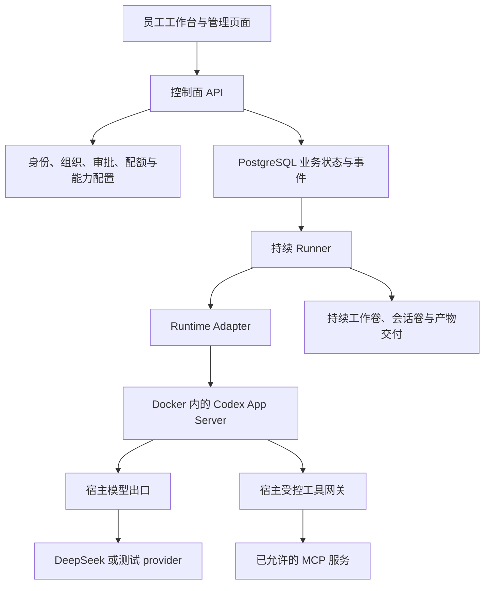

Codex Enterprise Agent 是我持续迭代的一套企业 Agent 工作台。员工通过网页描述任务、上传材料，在同一段对话里补充要求，最后取得报告或代码文件。管理员维护组织成员、模型请求额度和工具权限，控制外部写入的审批与执行。

项目基于固定版本的 Codex App Server 运行 Agent，模型通过宿主网关接入。自研部分覆盖桌面工作台、业务 API、任务与执行管理，以及文件、权限和能力目录。它已经有本机可运行版本，完成过多账号验证和前批人工反馈，最新能力仍按集中清单等待使用者验证。

这组记录按 2026 年 10 月 26 日的实现展开。项目当前完成的是工程试用，尚未验证生产高可用或大规模员工使用。下面先把产品和完整流程讲清楚，后续章节再进入实现。

## 我希望同事怎样用它

最初的入口是一次性任务。用户输入要求，后台运行完，再去下载文件。随着文件分析和代码任务接入，后续修改很难用一次提交表达完整，于是产品逐渐转向持续对话。

用销售报表核对这条已有验收流程说明，员工先上传本期材料，要求整理区域差异并生成报告。第一轮得到文件以后，可以在同一对话追加修订材料，再要求重算。两轮共用持续工作区，历史结果仍按各自轮次保存。

如果统计口径缺失，Agent 可以在当前任务中提出一个必要问题，员工选择以后，同一轮继续。任务执行中也允许补充文字；补充是否已被运行时接收，以及最终是否落实，要分别显示。

外部操作走另一条受控路径。Agent 提出工具调用时，平台保存具体参数，再由管理员审批。对话中的请求获批后由运行层继续，手动工具试用获批后则由成员明确执行。整个过程能回到原任务查看记录。

这些步骤来自产品的验收场景，不能推断真实模型每次都会给出正确统计。材料能被读到、工具受到授权、报告可交付，分别有工程证据；业务结论仍要核对。

## 当前有哪些可操作的页面

| 页面 | 用户在这里完成的工作 | 与其他模块的关系 |
| --- | --- | --- |
| 对话空间 | 发起任务、多轮修改、补充要求、回答澄清问题、停止本轮 | 每轮连接一个 Task，沿用同一对话工作区 |
| 文件与记录 | 阅读报告、查看原文、下载、比较历史轮文件 | 文件归属绑定具体任务，历史查看不改变当前状态 |
| 历史任务 | 查看旧任务输入、事件、用量和已有产物 | 新工作统一从对话开始，旧任务不直接一键重跑 |
| 我的工具请求 | 查看审批状态、手动测试已允许工具 | 对话自动执行与手动执行明确区分 |
| Skill 目录 | 发布、下载、追加版本和选择工作说明 | 成员直接发布，版本不可覆盖，内容不授予工具权限 |
| MCP 管理 | 管理员登记服务、测试发现、分发和停用工具 | 已分发工具才进入 Agent 可选范围 |
| 我的 Agent | 新建、复制模板、编辑和启停个人助手 | 组合组织允许的工具与精确 Skill 版本 |
| 审批与助手配置 | 审批请求，维护组织 Agent 模板和工具范围 | 管理权限与任务执行资格分别判断 |
| 组织成员 | 添加已登记用户、调整访问权限、移出与重新加入 | 成员变更影响新请求及未结束任务 |
| 模型请求配额 | 调整平台、组织、成员累计请求上限 | 模型出口在真实请求前检查三层余量 |

文件输入支持 ZIP、TXT、MD、CSV，以及 XLSX、DOCX 和文字型 PDF。输出包括已有文本与代码成果，以及受限的汇总 Excel。平台没有提供在线 Office 编辑器，也没有把扫描件 OCR 包装进已完成范围。

界面围绕白色桌面 Web 统一过一轮。对话输入框压缩高度，Agent、模型和用量信息靠近输入；重命名、置顶和归档放回会话列表。文件阅读支持原文切换和放大，长历史详情独立滚动。这些调整来自实际使用反馈，影响的是员工能否顺畅完成工作。

## 项目是怎样逐步做出来的

开发顺序先解决可执行和可追踪，再补人员协作与持续对话。能力目录最后接入已有治理流程，没有另起运行系统。

| 阶段 | 当时要验证的问题 | 后来形成的能力 |
| --- | --- | --- |
| 运行原型 | 能否脱离桌面 UI 驱动 Codex | 固定运行包、App Server 客户端、线程与轮次事件 |
| 执行管理 | 命令在哪里运行，取消后是否真的停止 | Docker 约束、资源身份、容器停止与回收 |
| 持久任务 | 进程崩溃后还能知道发生了什么 | Task/Run、启动命令、租约、事件和恢复观察 |
| 多账号治理 | 谁能提交、查看和执行 | OIDC 登录、组织资格、对象归属、配额与审批 |
| 持续工作 | 第二轮怎样继续原文件和上下文 | 原生线程恢复、持续卷、逐轮输入与产物 |
| 办公交付 | 同事手中的材料和需要的结果是什么 | Office/PDF 提取、报告阅读、Excel 输出与澄清 |
| 架构收敛 | 企业状态与 Codex 协议如何分开 | Runtime Adapter，以及运行时失联后的审批关闭 |
| 能力中心 | 员工怎样复用说明和工具 | 内部 Skill、MCP 分发、组织模板与个人 Agent |

P0、P1、P2 是不同阶段使用的开发标签。阅读整个项目时，按上面的问题与结果理解更清楚。早期学习记录中某项“尚未实现”，需要结合后续实现判断，不能直接当成今天的能力清单。

## 整体架构和实际依赖

工程主要使用 Node.js、Fastify、PostgreSQL、Docker 和 Keycloak。桌面页面沿用 HTML、CSS 和浏览器原生能力；MCP 使用已有 SDK，校验、身份协议和浏览器测试分别复用 Zod、openid-client 与 Playwright。

项目更接近带员工工作台的企业 Agent 控制面，并包含任务执行管理。它复用 Codex 的 Agent 循环和 Docker 引擎，重点实现企业业务状态与授权边界。当前没有接入 LangGraph，也没有开发自己的虚拟机或容器引擎。

开发中研究过 DeepSeek Harness 的能力组合和交互方式，例如 Agent 配置、工具与 Skill 的组织，以及当前轮内的澄清交互。当前系统使用自己的控制面、Runner 和 Codex 接入，没有引入 DSH 的 Cordis 插件运行框架。这些参考需要与实际复用的组件分别说明。

## 七篇记录分别回答什么

1. **本篇总览**说明项目的目标、产品范围与开发过程。
2. [架构与任务生命周期](/posts/codex-enterprise-agent-runtime/)沿一次提交，展开 Task、Run、Thread、租约和恢复。
3. [模型出口与容器执行](/posts/codex-enterprise-agent-execution/)讲清 Codex 如何调用 DeepSeek、密钥放在哪里、任务怎样停止。
4. [身份、审批与请求额度](/posts/codex-enterprise-agent-governance/)解释管理员、员工、工具请求和三层额度怎样协作。
5. [持续对话与办公文件交付](/posts/codex-enterprise-agent-files/)展开附件、续聊、版本差异、文档提取和 Excel 结果。
6. [Skill、MCP 与个人 Agent](/posts/codex-enterprise-agent-capabilities/)说明内部能力怎样发布、分发、组合和执行。
7. [验证、部署与项目复盘](/posts/codex-enterprise-agent-delivery/)交代自动测试、人工反馈、实际缺陷、部署恢复和后续工作。

只想了解作品，可以读完本篇，再看第七篇的完成状态。想追具体实现，沿一条流程逐篇看，会比先记住全部组件名称更容易。

## 当前成果应当怎样表述

能够说明的成果是员工任务流程已经连接起来，权限和外部副作用有明确的控制路径，文件与运行记录可以追踪；多轮修改沿用真实 Codex 线程和持续文件，能力配置按版本进入运行。

2026 年 10 月 26 日，能力中心相关实现经 PR 合并，九组 CI 作业通过。此前还有真实模型生成文档和修正代码的样例记录。免费测试模型负责验证工程路径，真实模型样例负责提供有限效果证据，两者不会相互替代。

仍需继续验证的包括真实办公材料、具体企业 MCP，以及第二台机器、长期运行和容量。没有员工目录同步、OAuth MCP、生产 Secret Manager 或高可用集群，也没有严格的外部业务单次写入保证。

下一篇从员工点击发送开始，追到数据库排队、Runner 领取，以及一个 Run 最终怎样结束。
