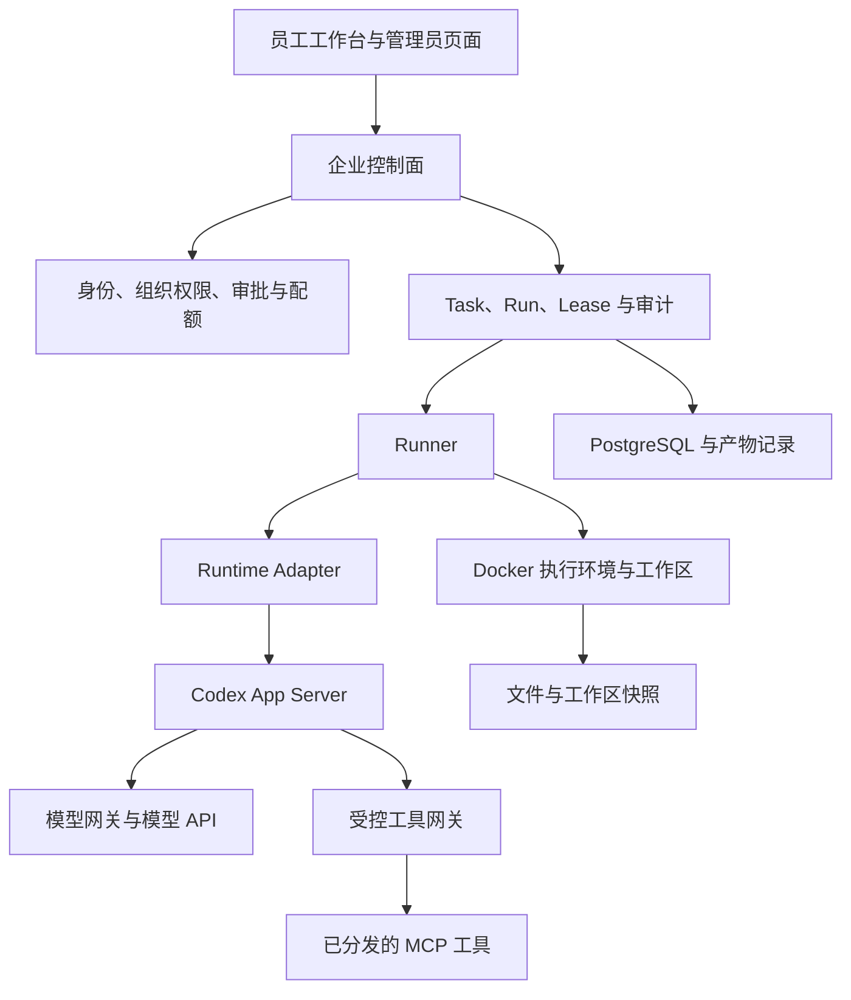

这个项目起初要解决的事情很具体。员工打开一个网页，上传手里的表格或文档，描述想完成的工作，然后拿到能继续使用的报告或文件。任务执行时间可能比较长，关掉页面后还应该继续运行。

沿着这条流程做下去，问题很快落到了聊天窗口之外。谁可以提交任务，工具写入由谁批准，成员权限变了以后正在等待的请求还算不算数，执行进程失联以后能不能再跑一次。这些问题最后成了 Codex Enterprise Agent 的主要工作。

截至这篇记录，平台已完成本机多账号验证，并收到前批功能的人工反馈。最新的 HTTPS MCP 与个人 Agent 仍留在集中验收清单中。这里记录的是自主项目的实现和本地验证，长期负载与生产高可用还没有验证。

## 员工在页面上能完成什么

工作台采用白色桌面布局。员工可以新建多轮对话，上传材料，在执行中补充文字要求，查看任务状态和工具审批结果。会话列表支持重命名、置顶、归档与恢复，避免所有工作都挤在同一个长对话里。

文件输入目前支持 ZIP、TXT、MD、CSV，以及 XLSX、DOCX 和文字型 PDF。输出文件可以预览、下载，并按轮次查看版本和差异。历史任务保留原始输入和已有产物，失败时有可用的中间文件，也能继续下载。

文件支持也有具体边界。扫描 PDF 没有接 OCR，Excel 公式不会在平台中重新计算，单文件上传仍受当前大小限制。读取失败时需要把原因留在页面上，已经输入的任务说明也要保住。为了支持办公材料，一次上传失败就丢掉整份草稿，会直接影响同事愿不愿意继续使用。

平台还提供成员管理和模型请求额度。额度按平台、组织、成员三层共同限制，实际可用量由三层剩余量的最小值决定。这里计量的是模型请求次数，一次任务可能请求模型多次，界面不能把一次任务误写成一次模型调用。

## 我把系统放在哪一层

项目整体更接近带有员工工作台的企业 Agent 控制面，同时包含任务调度和执行管理。

Codex App Server 承担 Agent 的模型与工具交互循环。平台通过 Runtime Adapter 调用它，管理线程和轮次事件；业务任务、成员权限、审批和额度则保留在平台中。DeepSeek 通过模型网关接入，自动化验证可以切换到免费的测试模型响应。

这张图里，自研的重点集中在业务治理和运行边界。模型权重、Codex 的执行循环以及 Docker 容器引擎都来自已有组件。项目没有引入 LangGraph，也没有实现自己的完整虚拟化沙箱。执行环境是在 Docker 上配置任务工作区、资源与权限约束，再管理容器生命周期和文件交付。

研究 DeepSeek Harness 时，我参考了能力组合和界面组织方式。当前实现使用 Codex App Server，相关工程取舍需要放回自己的任务、权限和运行模型中判断。两者的源码和运行框架没有混在一起。

## 业务任务和 Agent 线程为什么分开

员工发起的是一项业务工作，平台为它保存 Task。真正执行时会产生 Run，记录这一轮执行、所属 Runner 和租约。Agent Thread 则保存运行时对话上下文，负责让模型在后续轮次接着工作。

它们的生命周期会交叉，却不能互相代替。一个线程仍然存在，不足以说明员工还有执行资格；模型返回了文字，也不足以说明文件已经交付，或者外部写入已经确认。

因此，任务成功需要平台自己的执行和产物证据。成员权限、工具授权和额度也在控制面判断，模型上下文里记住的旧信息不能成为授权依据。

Runtime Adapter 在这里保持得很薄。它把线程开始、恢复、轮次提交和事件转换集中起来，Runner 继续负责租约、工作区和任务收尾。这样以后需要换运行时，可以先替换适配层及其内部执行部分，企业业务状态仍有明确归属。

## 一条批准过的请求，也可能必须拒绝

工具审批里有一个很容易漏掉的情况。管理员批准请求以后，员工的权限可能被撤销，工具也可能被停用。先停用再启用，旧审批是否应该恢复有效，同样需要明确答案。

当前实现会记录成员、Agent 和工具授权的版本，并在执行前重新检查。撤权后再授权会进入新的版本，旧请求不会因此重新获得执行资格。任务已经结束、审批超过有效期，或者 Run 的租约已经失效，也会阻止继续执行。

数据库锁等待让这个问题更细了一步。请求进入事务时仍然有效，等到真正拿到任务锁，租约可能已经过期。如果继续使用等待前的时间判断，就会放行一条已经失效的操作。为此，审批和执行路径会在获得锁后，再依据数据库时钟检查期限。

恢复测试还发现过事务处理上的问题。代码更新了关闭状态，随后抛出拒绝错误，整个事务却一起回滚，界面下一次仍会看到旧审批。修复后，系统先提交关闭记录与拒绝审计，再返回失败响应。同一个幂等键重试，仍然得到关闭结果。

这些行为使用隔离 PostgreSQL 的真实锁竞争验证，不能只靠页面上出现一个红色提示来判断。

## 远程 MCP 最难处理的是结果丢失

最初平台只接部署内置的测试工具。新增通用接入后，管理员可以登记多个公共 HTTPS Streamable HTTP MCP 服务，使用无认证或 Bearer 认证，测试连接并发现工具，再显式分发给组织。

员工可以使用已经分发的工具，连接地址和凭据由管理员维护。不同服务提供同名工具时，平台仍然为它们分配不同身份，避免把一个服务的审批应用到另一个服务。

连接配置会检查公共 DNS 地址，并把实际 HTTPS 连接固定到已经检查的地址。重定向、内网和保留地址会被拒绝，TLS 校验与响应大小限制同时生效。Bearer 按组织和服务加密保存，更换端点时必须重新输入，避免把旧凭据静默发给新目标。

所有第三方工具在当前版本都需要审批，即使服务声明工具只读，也继续使用平台自己的审批策略。这个选择牺牲了一部分操作便利，换来了首版统一、可验证的授权行为。

真正麻烦的情况发生在调用已经发出以后。远端可能完成了写入，本地却因为连接中断而收不到返回值。平台此时只知道结果不确定，直接重发就可能重复写入。

当前处理先持久化一次执行占用，再派发远程请求。发出以后无法确认结果，工具及其所属任务进入 `outcome_unknown`，页面显示待核实，系统不自动创建第二个 Run 来重放。

这保证的是平台不会自动重复派发。外部业务能否做到严格的单次写入，还需要对方系统支持幂等键、事务或补偿机制。当前项目没有把这些能力写成已经解决。

## Skill 和个人 Agent 怎样组合

内部 Skill 目录允许成员上传、下载和追加 `SKILL.md` 版本。内容校验通过后直接发布，平台没有给 Skill 增加管理员审核。Skill 用来说明怎样工作，本身不能增加网络或工具权限。

Agent 绑定明确的 Skill 版本，新会话创建时保存配置快照。作者发布 v2，已经采用 v1 的会话仍然保留原版本，升级需要明确选择。

员工还可以创建个人 Agent，填写工作要求，选择组织已允许的工具和 Skill，也可以从组织模板复制。个人配置仅本人可见，复制后不会随着组织模板的后续修改自动变化。它使用部署提供的模型，不能携带个人模型凭据扩大权限。

这部分还补过一个隐私边界。审批人需要看到工具参数和结果，审批接口却不应该附带个人 Agent 的完整指令与 Skill 内容。最终数据库继续保留运行快照，HTTP 审批响应只返回工具请求信息。

## 我用什么证明它跑通了

本批本地测试中，74 项单测通过，其中 11 项针对远程 MCP 传输与边界。它们之外还有 API、浏览器和运行时集成验证，测试范围分别记录。

完整链路使用真实 TLS 测试服务、PostgreSQL、Playwright 和固定 Codex 运行物。测试模型返回预设响应，推动个人 Agent 发起远程工具调用，等待审批，再经过 HTTPS 获得结果并生成报告文件。它能证明平台链路实际连接起来，不能单独证明真实模型的任务质量。

故障验证另外覆盖了连接过程中撤权、并发提交同一执行请求，以及远端收到请求后断开连接。对应观察结果是撤权后没有外部写入、并发不会重复派发、结果丢失后保留待核实状态。独立复核也检查了撤权竞争和审批接口的隐私返回。

更新本机试用时，先确认没有在途任务，再备份数据库和应用迁移。随后核对 21 张业务表原有字段的行数与摘要，确认原账号、历史记录和额度保持一致，文件卷也继续保留。这只能说明这次更新保留了已有数据，跨主机恢复还需要单独演练。

## 目前停在哪里

现在可以继续验证的，是同事拿真实办公材料完成任务时的效果，以及某个具体第三方 MCP 的业务契约。公共 HTTPS 通用协议已用测试服务验证，真实企业服务仍需要逐个接入确认。

OAuth、内网 MCP、自签证书和任意 stdio 服务还没有开放。长期运行、容量、跨主机恢复和生产高可用也没有完成验收。后续如果出现跨进程人工等待、复杂分支或第二种运行时需求，再评估是否把 Agent 内部编排交给 LangGraph。

目前最值得继续观察的是同一条真实工作流程。员工上传材料，选择自己的 Agent，产生报告，遇到受控写入时完成审批，失败后又能明确知道哪些事情已经发生。这个过程跑顺了，才有依据决定下一步应该扩展哪一部分。

相关学习可以接着读 [如何构建一个 Agent](/posts/how-to-build-an-agent/) 和 [DeepSeek Harness 学习笔记](/posts/deepseek-harness-notes/)。
