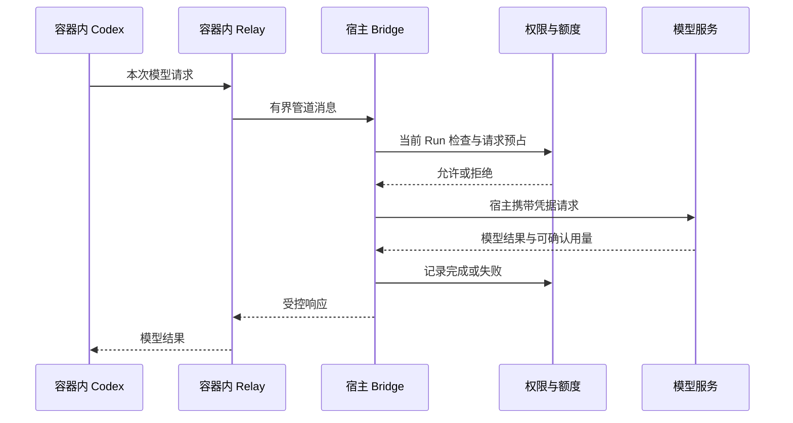

> [系列总览与完整目录](/posts/codex-enterprise-agent-control-plane/)

让模型执行代码之前，需要先确定执行者能接触哪些东西。这个项目把可信管理程序放在宿主，把 Codex 和任务命令放入 Docker。任务能修改自己的工作区，控制面数据库、Docker 管理接口和模型供应商密钥留在外面。

这层负责的是执行环境和模型出口。业务任务的领取与恢复在上一篇讲过，成员和工具审批则在下一篇展开。

## 为什么先固定运行包

直接调用桌面应用 PATH 中的 Codex，会受到桌面自动升级和个人配置影响。不同机器即使用同一份平台代码，协议和默认行为也可能不同。

项目为运行包保存版本、官方资产名称、源码提交和 SHA-256。安装时校验下载包，启动时核对版本，并使用独立 HOME 与 CODEX_HOME。当前部署基线是 Codex 0.153.4，宿主 Node.js 固定为 24.15.0。

运行镜像由固定基线构建，实例配置记录具体镜像摘要。未来执行使用更新后的镜像，历史任务保留原来的镜像记录，便于解释某一轮当时运行在哪个环境。

独立配置目录用于减少个人状态干扰，Docker 约束负责执行隔离。这两项分别验证，不能只因为换了 HOME 就认为已经有安全沙箱。

## 任务容器实际受到哪些限制

| 约束 | 当前实现 | 对任务的影响 |
| --- | --- | --- |
| 用户 | 非 root，UID/GID 为 1000 | 普通任务不能获得容器 root 身份 |
| 文件系统 | 根目录只读，任务工作区使用专属卷 | 输出写入工作区，系统目录不能任意修改 |
| 网络 | Docker network none | 不直接访问公网，也不能安装在线依赖 |
| 管理权限 | 无 Docker socket、清空 capabilities、禁止提权 | 任务不能通过已有管理入口改变容器权限 |
| 资源 | 1 CPU、768 MiB 内存、256 个 PID | 对单任务资源设置上限 |
| 凭据 | 不注入模型供应商密钥和控制面管理凭据 | 模型与工具调用通过宿主受控出口 |

这些是当前容器启动实现中的值，并非生产容量建议。宿主仍需要管理 Docker，容器也共享内核。项目没有进行完整容器逃逸测试，磁盘配额和压力测试也没有因此完成。

隔离验证同时看声明与行为。先用 Docker inspect 核对配置，再实际尝试写系统路径、通过符号链接越界、访问外网和 Docker socket。工作区正常写入作为正例，避免把一个根本没有成功启动的容器误判为安全。

## 无外网容器怎样使用 DeepSeek

Codex 在容器里调用一个本地模型入口，请求经 relay 和专用进程管道送到宿主。宿主确认当前任务仍可执行，记录请求并占用额度以后，才调用真实 provider，再把受控结果送回 Codex。

Bridge 对消息体积、顺序和同时在途请求做限制。请求开始与完成之间还有权限检查，取消和撤权可以中断本地等待。供应商可能已经收到请求，平台不能据此保证对方不计费。

供应商 Key 不进入任务容器配置、浏览器存储或模型输入。当前持久实例使用宿主侧受保护的本地配置；运行时由宿主出口使用。它还不是集中 Secret Manager，也没有实现企业统一密钥轮换平台。

## 模型循环由谁负责

Codex 获得模型结果后，会决定继续读取文件、执行命令还是调用动态工具。工具结果回到上下文，模型再决定下一步，直到这一轮结束。

平台管理任务期限、权限和结果交付，不通过自己拼几个固定分支来代替 Agent。自动化测试时可以提供预设模型响应，以便稳定触发某种行为；真实模式则由 DeepSeek 进行推理。

这也解释了两类证据的差别。2026 年 9 月的真实模型样例生成过文档，也修改过算术代码；某次成功复验中分别用了 2 次和 6 次模型请求。它们只是当时样例，不是吞吐指标或任意任务成功率。免费 provider 测试则能反复验证命令与授权流程，但不能证明真实模型理解任务的质量。

## externalSandbox 的选择来自实际兼容问题

早期尝试在容器里重复启用 Codex 的 Linux 沙箱，遇到了 namespace 限制。当前运行路径使用 externalSandbox 模式，让 Codex 在平台已经配置的 Docker 边界内工作。

这意味着平台必须自己验证只读根目录、无外网、资源与权限限制。运行时配置里的“使用外部沙箱”只是职责声明，实际保护来自容器启动和监管实现。

任务工作区内写报告不需要每个文件都由管理员点击批准。企业工具写入的审批在受控工具网关进行，操作对象和参数明确绑定。两种路径承担不同职责，不能把工作区写文件等同于获准修改外部业务系统。

## 用户点击停止以后发生什么

停止分成意图、协议和环境三个阶段。平台先保存取消意图并停止放行后续受控操作，再尝试中断运行时；有限等待以后仍未结束，就停止整个容器，最后观察状态并记录清理结果。

真实测试故意启动过脱离原进程组、忽略终止信号且持续写文件的子进程。杀掉宿主 attach 客户端后，文件仍然增长。最终验收观察的是容器退出、没有运行 PID，以及文件不再增长。

退出码也只能提供部分信息。例如 137 常见于 SIGKILL，但还可能涉及 OOM。测试同时检查 OOMKilled，而非只凭退出码宣布按预期终止。

删除容器失败以后，系统可以继续核实和重试资源清理，却不会重新执行模型任务。容器停止、资源移除和业务成功是三项不同事实。

## 这套环境目前适合什么任务

当前适合受限的文档、数据和代码处理，输入与输出有明确大小范围。任务环境无外网，不支持任意依赖安装，也没有接通真实 Git 仓库或自动提交 PR。

上传代码任务还保留原始测试基线。已有验证专门防止任务通过修改测试文件或提前退出，伪装成原测试通过。能输出文件与能证明代码正确仍需要分开判断。

后续扩展联网或更复杂工具，需要重新评估出网目标、凭据和工作区约束。当前不通过给所有容器打开网络来绕过这些限制。

[上一篇 · 任务与恢复](/posts/codex-enterprise-agent-runtime/) · [下一篇 · 身份与治理](/posts/codex-enterprise-agent-governance/)
