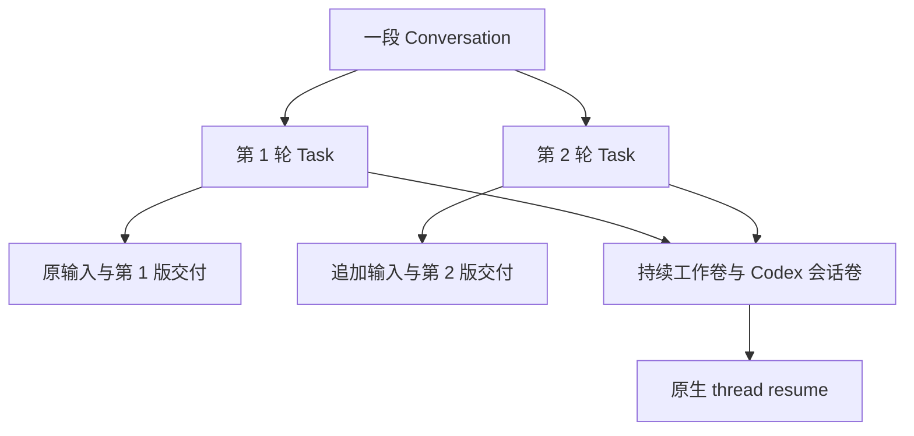

> [系列总览与完整目录](/posts/codex-enterprise-agent-control-plane/)

一次任务能够生成报告以后，用户接着会要求修改。第二轮拿到修订材料，还需要继续使用第一轮的文件，不能重新开始一切；查看旧结果时，又不能把当前文件冒充旧版。

持续对话因此同时牵涉运行时上下文、工作文件和每轮交付记录。页面上的聊天气泡只是其中一部分。

## 每轮任务独立，工作区持续保留

对话记录关联多轮 Task，每轮保存自己的输入、用量、审批、事件和产物。对话另有持续工作卷和 Codex 会话卷，容器则按轮创建和结束。

下一轮必须等上一轮成功且资源状态允许恢复。数据库限制同一工作区不能同时有两个活跃执行；旧容器确认停止并移除以后，新容器才复用持续卷。

恢复使用 Codex 原生线程，模型能继续查看原来的工作文件。平台没有仅靠把旧报告重新拼进提示词来假装恢复。已登记产物则按轮保留，持续工作区中的修改不会覆盖数据库保存的第一版交付。

## 运行中补充与下一轮是不同操作

任务尚在运行时，用户可以追加文字，通过 `turn/steer` 送入当前原生轮次。当前阶段不接收运行中的新附件，也不重新开始本轮计时。

补充内容先持久化，再由 Runner 领取和投递。运行时确认接收以后，页面才能显示相应状态；接收仍不能证明最终结果已经落实。

固定版本 Codex 的消息关联标识没有替平台完成去重，重复投递仍可能被接收。因此平台保存幂等请求，并在无法确认投递结果时停止自动重发。一次“补充要求”也可能影响文件操作，不能因为它是聊天文字就忽略重复风险。

澄清问题复用动态工具。Agent 在当前任务提出一个关键问题，通常给 2 至 3 个选项，可允许有限自定义回答。答案作为工具结果回到同一轮，保留当前附件和工作区。

等待问题时，普通补充暂停，用户仍可停止。等待占用执行槽并计入当前总时限，没有实现跨天挂起、多问题分支或任意断点恢复。

## 附件从原件到模型输入

每轮接受一个上传文件。首轮文本输入放入初始工作区，后续附件按轮进入独立目录，例如 `attachments/turn-N/`，避免两轮同名文件互相覆盖。

上传归属、消息与轮次在事务中校验，重复提交不能多建一轮。原件按原始字节保存，模型工作输入则是校验后的文本或提取结果。下载原件与查看提取内容各有用途。

| 输入 | 当前处理 | 必须说明的限制 |
| --- | --- | --- |
| TXT、MD、CSV | 校验编码和大小，导入文本工作区 | 不是任意编码或无限文本输入 |
| ZIP | 校验条目和展开内容，导入允许的文本或源码 | 拒绝路径穿越、链接和解压膨胀等越界内容 |
| XLSX | 提取有界表格数据，保留多表及单元格位置 | 使用可读取的缓存值，不重新计算公式 |
| DOCX | 提取段落和表格文字 | 不承诺图片、复杂排版和版式保真 |
| PDF | 按页提取文字并记录读取情况 | 扫描页无 OCR，无文字材料不能冒充完整读取 |

文档提取复用原有上传、权限和历史保存，在隔离容器中完成有界转换。它没有给任务开放一个任意运行 Office 二进制的能力，也没有增加第二套文档管理系统。

当前上传上限为 2 MiB，单个文本文件最多 512 KiB；对话累计展开输入最多 4 MiB、128 个文件。达到限制应给出原因，并保留尚未发送的文字。格式校验通过，也不代表模型一定正确理解了业务含义。

## 产物由交付层登记

模型回复里提到一个路径，不足以证明文件实际存在。任务停止后，可信交付程序采集符合范围的文件，记录大小、摘要与归属，再作为可下载产物登记。

采集拒绝不允许的符号链接、目录和超限内容。代码任务还要核对原始测试基线，不能靠修改测试文件来获得虚假的通过结果。失败任务可以保留可用中间文件，但状态不能因此被改成成功。

Artifact 在这里指已登记的交付物。工作区里可能还有未交付的临时文件，二者不是同一个集合。用于文件比较的快照和用于运行时恢复的会话数据也有不同用途。

文件链接绑定消息所属 Task，再精确匹配已登记的唯一产物。点击历史回复里的 `report.md`，应打开那一轮的文件，不能按名称从最新工作区随便找一个替代。

## 文件差异为何需要完整性标记

平台在执行边界之外保存允许范围内的文件快照，比较实际内容，展示新增、修改、删除或未变化。前端把补丁作为纯文本显示，缺少完整快照时明确指出无法完整比较。

失败任务只采集到部分文件时，不能因为某个文件没有出现在结果里，就断言它被删除。文件目录完整性决定比较能够回答哪些问题。

Markdown 报告提供阅读和原文两种方式，复杂内容可以回退原文。代码、CSV 和差异仍保持字面内容；受限 Markdown 不执行 HTML、脚本或任意图片加载。

预览和下载请求由后端重新校验权限，放大和复制使用已经加载的内容。用户切换组织或退出后，旧预览要清空，迟到响应不能把先前的私有内容重新放回页面。平台无法收回已经复制到外部的文字。

## Excel 输出采用受限数据定义

能够读取 Excel 以后，同事还会希望得到可继续加工的表格。当前输出没有引入完整 Office 编辑环境，模型先写固定格式的数据定义，可信交付层再生成新的 `report.xlsx`。

生成器使用有时间、大小和内存上限的固定 Node 子进程。只接受基本单元格类型，日期和长编号用文本，不执行任意模型脚本。这个宿主子进程本身不是隔离沙箱，保护依赖受限输入和固定生成逻辑。

| 输出约束 | 当前上限或规则 |
| --- | --- |
| 工作表 | 最多 8 张 |
| 表维度 | 每表最多 5000 行、64 列，总计 20000 格 |
| 数据定义与成品 | 定义最多 512 KiB，成品最多 1 MiB |
| 内容 | 基本类型，不支持公式重算、宏或原版式编辑 |

测试会保存后重新读取真实单元格值。独立审查曾发现类似 `_x0041_` 的文字被表格库当成转义串，修复后检查字面编号和完整表名能够正确读回，文件头检查无法发现这种内容变化。

端到端验证使用合成材料，第一轮计算出 30，第二轮修改后得到 35，并检查第一轮和原件字节继续保留。这证明了生成与历史链路，不能替代真实财务口径核对。

## 页面状态也属于交付的一部分

未发送草稿按当前页面内的组织与会话保存，切换对话可以保留，退出、切组织和浏览器重载等边界会清除。它没有持久写入浏览器存储，页面也应在可能丢失未发送内容时提醒。

轮询状态时，页面尽量只更新变化部分，保留文件控件、选中文字和键盘焦点。主状态关注当前轮，文件面板可以浏览旧轮，二者不能相互覆盖。

人工反馈还推动了附件大小显示、旧错误清理和历史详情滚动修复。员工需要据此判断上传是否成功、看到的是哪一轮，以及下一步还能做什么。

[上一篇 · 身份与治理](/posts/codex-enterprise-agent-governance/) · [下一篇 · 能力中心](/posts/codex-enterprise-agent-capabilities/)
