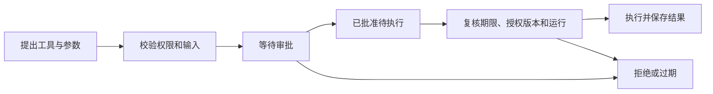

> [系列总览与完整目录](/posts/codex-enterprise-agent-control-plane/)

一个员工已经登录，仍然可能没有当前组织的任务资格。管理员能够维护成员和额度，也不意味着可以打开所有员工的工作文件。项目从演示身份转向真实账号以后，把身份认证、组织授权与对象归属分别保存和检查。

这篇说明三类实际规则怎样落到执行路径上。它们涉及登录请求、后台 Runner 和模型出口，单独限制页面按钮还不够。

## 登录过程把什么交给身份服务

账号与密码由 Keycloak 管理。平台发起 OIDC 登录时生成一次性 state、nonce 和 PKCE 数据，回调时验证授权码与浏览器绑定，按 issuer 和 subject 确定平台用户。

密码提交给身份服务，平台业务库保存组织资格、任务和产物。浏览器使用随机 HttpOnly Cookie，数据库保存会话摘要；写入请求另做 Origin 与 CSRF 检查。

登录成功以后，业务 API 仍逐次确认有效用户、组织成员资格及任务归属。修改 URL 中的任务 ID，或者直接请求文件下载地址，都要经过相同的对象授权，不能只靠前端列表隐藏别人的任务。

浏览器也处理身份变化。同一浏览器的另一标签页换账号以后，当前页面不能继续使用旧身份的缓存文件。迟到响应返回时，要再次核对它属于哪个身份和组织，才能更新画面。

## 成员权限为什么没有只用一个布尔值

| 权限或状态 | 当前含义 |
| --- | --- |
| 可执行任务 | 可以在所属组织提交和运行，仍受工具及额度约束 |
| 仅可查看 | 可以阅读本人历史和已交付文件，不能提交新任务 |
| 禁止访问 | 保留成员记录，但阻止当前组织的执行和读取 |
| 移出组织 | 从当前成员列表退出，历史外键与用量记录继续保留 |
| 平台管理员 | 可以执行相应管理操作，不自动获得组织执行资格或他人文件权限 |

页面最初使用“角色”和“资格”两个字段，人工试用时不容易理解。后来改成三种业务访问级别，后端仍映射到原有授权字段。移出又作为独立动作，避免与保留名单中的禁用混淆。

重新加入复用原成员身份和额度桶，不通过创建新记录清零历史。添加候选在数据库按组织过滤后再分页；过期页面和并发添加仍由写接口拒绝重复。

## 撤权要影响已经排队或运行的任务

如果只修改成员有效状态，用户很快恢复权限，Runner 的轮询可能看不到中间发生过撤权。因此成员变更事务同时保存停止意图，并取消排队任务。恢复资格不会删除已经写下的停止请求。

运行中的任务由监管路径确认容器停止以后再收尾。旧请求即使碰到恢复后的新成员状态，也不能沿原路径继续。已发送到供应商的模型请求、已经发生的外部写入不能被本地撤权撤回。

成员变更、停止意图和审计在同一事务里提交。测试会制造审计写入失败，检查前面的资格变化是否一起回滚，避免出现权限已经改动却没有审计事实。

## 审批批准的对象到底是什么

模型提出的是一个工具意图。平台先验证工具和参数，保存具体请求、所属成员、Agent、任务与运行，再决定是否进入等待审批。

当前内置记录写入需要审批；远程 MCP 的所有第三方工具也统一要求审批。请求创建后五分钟失效，批准不延长有效期。对话内调用还受本轮任务剩余期限约束，不能据此无限挂起。

手动试用和对话调用执行方式不同。成员手动请求获批后，需要本人明确执行；对话请求由等待中的运行层继续。这能避免一个审批结果同时被两套入口重复当成执行指令。

批准的是这一份具体参数，审批人不能顺手编辑成另一条命令。执行前还会核对成员、Agent 和工具授权版本。停用后再启用会改变版本，旧批准不会恢复有效。

## 版本校验和幂等键各管一件事

两位管理员可能同时打开同一配置。版本校验拒绝过期草稿覆盖新状态，前端保留尚未提交的修改，要求明确重载最新配置。

网络断开后的重复提交则由幂等键处理。同键同内容复用结果，同键换内容拒绝，不能因为重试重复生成审计或执行。版本校验解决并发覆盖，幂等解决重复投递，两者都不能替代权限检查。

持有数据库锁也不能省略时间复核。请求开始时有效，等到取得任务锁可能已经过期，所以执行和审批在锁后再次读取数据库时钟。

本地测试记录可以把写入和成功状态放进一个事务。远程业务调用跨出数据库边界，结果丢失要按未知处理，具体机制留在能力中心篇展开。

## 三层配额如何限制一次模型请求

平台计量的是累计模型请求次数。一次 Agent 任务可能经过多轮模型与工具交互，不能用任务数量代替模型调用次数。

实际可用量由平台、组织、成员剩余量的最小值决定。为便于说明，假设三层还分别剩 100、30 和 8 次，这位成员最多还能请求 8 次。这是规则示例，不是当前实例的真实用量。

每次真实 provider 调用之前，模型出口根据可信任务归属执行预占。一个数据库事务同时检查三层，全部允许才一起增加计数；任一层不足，三层都不扣，也不触达供应商。

唯一请求流水防止同次请求重复计数。模型请求已经预占，后续失败或取消不会自动退款；停止本地等待不能证明供应商没有接收和计费。usage 无法确认时保留未知，不将它写成零。

管理员修改累计上限，已用次数不清零。新上限不得低于已用；设为恰好等于已用可以阻止后续请求。增加额度也不会自动复活已经失败的任务。

## 验证落在实际动作上

治理回归覆盖真实 Keycloak 登录、PostgreSQL 并发、两种浏览器身份，以及固定 Codex 容器。成员撤权测试检查持续写文件的容器被停止，审批测试检查批准前没有记录，额度测试检查超额请求没有进入 provider。

并发测试还验证最后一个模型请求名额只被一个执行者取得。跨组织、只读、退出后 Cookie 重放与旧审批重试分别有拒绝路径，不能把“页面不显示按钮”当作后端拒绝证据。

当前仍是本机治理实现。它没有连接企业员工目录，也没有实现金额计费、周期账单或组织管理员委派。规则可以说明清楚，生产规模下的性能和运维仍需另外验证。

[上一篇 · 模型与容器](/posts/codex-enterprise-agent-execution/) · [下一篇 · 对话与文件](/posts/codex-enterprise-agent-files/)
