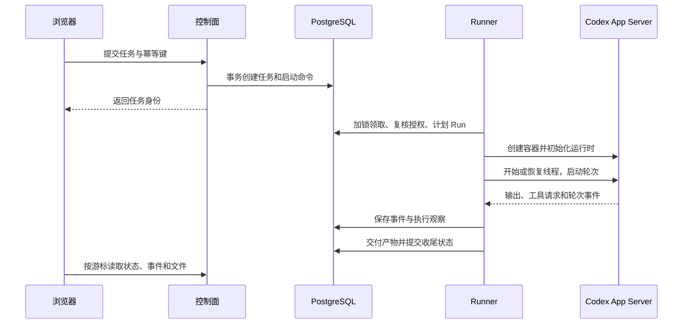

> [系列总览与完整目录](/posts/codex-enterprise-agent-control-plane/)

网页提交成功以后，真正的执行才刚开始。请求可能停在队列里，Runner 也可能在创建容器后退出。要让页面说清现在发生了什么，平台需要保留业务记录，并且知道哪些状态来自观察，哪些只是操作意图。

这一篇沿当前项目的任务路径展开。相关实现集中在控制面存储、Runner、Runtime Adapter 和对话运行层，下面的名称都对应实际存在的职责。

## 先把几个容易混在一起的对象分开

| 对象 | 在本项目中的含义 | 保存什么 |
| --- | --- | --- |
| Conversation | 员工看到的一段持续对话 | 标题、归属、轮次，以及会话整理状态 |
| Task | 一轮具体业务工作 | 输入、任务状态、事件、用量和产物 |
| Run | 一次执行记录 | 执行代次、租约、资源身份和收尾观察 |
| Runner | 可信的后台执行管理程序 | 领取任务，监管运行时、容器和交付 |
| Thread | Codex 原生对话上下文 | Agent 的历史交互与运行时状态 |
| Turn | Codex 中的一轮交互 | 当前输入及其执行过程 |
| Session | 需要结合上下文说明 | 浏览器登录会话与 Codex 会话数据是两种东西 |

当前对话的每一轮创建独立 Task，通过轮次记录关联到 Conversation。同一对话保留工作卷和 Codex 会话卷，后续成功轮次可以恢复原线程。一个 Task 在目前策略中不会因为结果未知而自动产生第二次业务执行。

Task 说明用户这轮要做什么，Run 说明谁尝试执行了它，Thread 为模型保留上下文。线程能恢复，不代表成员仍有权限，也不代表上一次外部写入可以重做。

## 从发送到执行领取

控制面先校验登录、组织资格、任务类型、输入和所选 Agent。任务创建与启动命令在同一数据库事务提交，防止任务已经登记，却没有任何待处理启动记录。

网络重试使用幂等键。同一个键携带同样内容时，返回原结果；同一个键换了内容则拒绝。这里解决的是重复接单，真正执行了什么还需要独立记录。

Runner 在 PostgreSQL 中竞争领取。事务检查当前并发名额，再锁定可执行任务并复核成员资格，随后计划 Run。资源身份先记入持久记录，创建容器时再使用它。进程即使卡在创建与回报之间，后续恢复者仍有依据寻找资源。

后台会持续检查取消、权限和租约。一次授权通过只说明当时允许执行，排队时间和长命令都可能跨过后续变化。

## Adapter 怎样接住 Codex 协议

Codex App Server 通过进程管道交换 JSONL。请求用 ID 关联响应，执行进展通过通知到达；某些审批或动态工具请求还会反向等待平台回复。

`turn/start` 返回只说明运行时接受了这条命令。平台仍然需要等待完成事件，并检查任务的实际交付情况，不能在收到请求响应时直接宣布成功。

Runtime Adapter 把 `thread/start`、`thread/resume`、`turn/start` 和 `turn/steer` 等操作集中起来，也暴露当前所需的事件与工具处理入口。它没有保存组织、任务或额度，也没有提供一个让上层随意发送任意 RPC 的通用出口。

这样的边界比较薄。平台当前只有一种运行时，提前拆出独立服务会增加部署与恢复成本。等到真的需要第二种运行时，再比较其上下文和工具语义，适配这一层；企业任务和审批记录仍然留在控制面。

## 事件序号需要与提交顺序一致

任务页面按游标读取事件，因此事件顺序会直接影响它能否完整回放。

开发中专门验证过一个数据库问题。事务 A 先取得序号 5，事务 B 后取得序号 6，但 B 先提交。客户端读到 6 后把游标推进到 6，A 稍后提交的 5 就可能被跳过。

当前实现对同一任务的事件追加进行串行化，在短事务里更新计数、插入事件并提交。测试会故意阻塞一个事务，观察后来的事务等待任务行锁，再验证分页和回滚后的结果。

代价是单个任务的事件写入不能无限并行。因此事务里不放模型调用或远程网络等待。这个约束来自页面回放的需要，不能扩大为整个系统已经实现通用事件流服务。

## 租约解决不了进程是否仍在运行

Run 的租约有期限，Runner 需要续期，并使用当前执行令牌报告心跳、事件和完成结果。恢复者切换令牌后，旧 Runner 的数据库回报失效。

但是，旧执行者已经发出去的系统命令不会随令牌变化消失。真实故障实验里，强杀宿主 Runner 后，Docker 容器和其中持续写文件的子进程仍然运行。

所以恢复路径需要核验容器归属，观察它的实际状态，再尝试停止和回收。工作区在无法确认时保持隔离，不能因为租约过期就再启动一个写入者。

| 情况 | 平台采取的动作 |
| --- | --- |
| 排队任务收到取消 | 取消启动意图，不创建新的执行容器 |
| 正在执行时取消 | 记录取消意图，打断运行时并确认容器停止 |
| 删除容器失败 | 保存清理失败，可继续核实清理，不能重跑业务 |
| 租约失效且结果无法确认 | 标记待核实，拒绝旧令牌上报和自动重放 |
| 已确认容器停止但业务结果仍不明 | 保留未知结果，停止观察不会替代业务确认 |

任务状态与资源清理状态因此分别记录。成功、失败、取消、待核实描述业务结果；容器是否移除、工作区是否保留，属于另一组事实。

## 恢复还要关掉悬空的交互

持续对话接入以后，任务失联还可能留下已领取的补充消息、等待回答的问题和待审批工具请求。旧页面如果继续显示可操作，用户就会向一个已经失效的运行提交内容。

P1 收尾复用已有持久状态，把不能确认投递结果的消息和问题标记为待核实，同时关闭相关工具调用。审批入口返回关闭结果，执行入口也不能产生新的工具写入。重复清理保持幂等，不另建一个 Run 来假装恢复。

独立复核曾找到锁顺序不一致、锁等待后租约过期，以及抛错导致关闭记录回滚等问题。修复统一了事务锁顺序，在拿到锁后重新检查数据库时间，并让关闭记录先提交，再返回拒绝。

## 如果以后引入 LangGraph

目前项目仍使用 Codex App Server，尚未引入 LangGraph。未来出现明确的多分支编排或跨进程等待需求时，可以评估 Agent 内部执行部分及 Adapter 后的运行实现。

替换范围需要按真实契约确定，不能承诺改一个类就完成迁移。平台已经承担的身份、业务 Task、文件归属和审批审计，不应随着框架变化重新交给模型状态管理。

下一篇进入运行环境，说明无外网的任务容器如何使用模型，以及平台怎样确认任务真的停止。

[上一篇 · 产品总览](/posts/codex-enterprise-agent-control-plane/) · [下一篇 · 模型与容器](/posts/codex-enterprise-agent-execution/)
