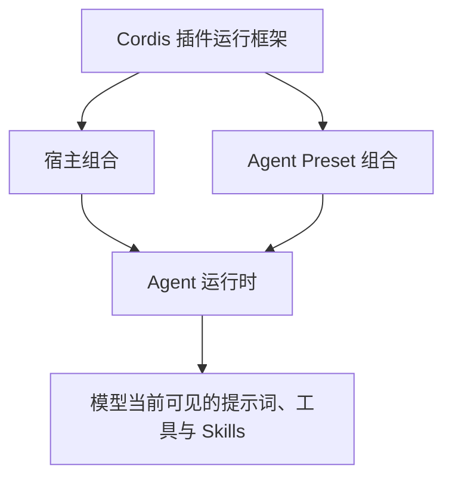

> 上层总纲 [如何构建一个 Agent](/posts/how-to-build-an-agent/)

我开始看 DeepSeek Harness 时，先把它当成一个可以换模型、加工具的编程 Agent。真正复制了一份 Agent Preset，又把它改成只保留网页检索以后，这个理解才发生变化。模型看到的工具已经只剩网页搜索，后台的模型路由、会话存储、权限和 Token 统计却仍在运行。

这次实验给了我一个很实用的入口。理解 Harness 时，可以先分清三件东西。

| 层次 | 负责的事情 |
| --- | --- |
| DeepSeek Harness | 提供完整的 Agent 产品和共用运行设施 |
| Agent Preset | 组装一个会话中的 Agent，让模型获得特定提示词、工具和 Skills |
| Cordis | 挂载插件、提供服务、处理依赖与生命周期 |

宿主和 Preset 都由 Cordis 组装，作用范围不同。宿主保存多个 Agent 共用的服务，Preset 控制某个 Agent 的模型视图。模型路由可以留在宿主中，网页工具则由 Preset 决定是否出现。

## 已整理的文章

1. [Agent Preset 如何组装一个 Agent](/posts/deepseek-harness-agent-preset/)

   从纯网页检索 Agent 的实验出发，说明宿主能力和模型可见能力怎样分开，并区分 Skill、Tool、Workflow 与 Preset。

2. [Cordis 如何组织 Harness 的插件](/posts/deepseek-harness-cordis/)

   继续拆 Plugin、Service、Context、Inject、Effect、Event 与 Scope，解释 Preset 为什么能够按会话挂载不同能力。

## 后续准备继续拆的部分

会话日志与上下文压缩可以单独成篇。这里需要解释持久记录、模型当前看到的 Surface，以及压缩事件怎样把一段旧内容替换成摘要。

工具执行链也值得单独讲。权限、审批、超时、重试和遥测都可以在工具真正执行前后介入，模型工具与宿主安全策略因此能够分开维护。

再往后是 Workflow、计划、目标和子 Agent。这几块都涉及跨步骤状态，适合结合一个完整任务来讲。最后再回到 ChatBI，尝试把数据库查询、指标解析和报表生成组装成一个专用 Agent。

这组文章采用一个系列目录和多篇子文章。各篇可以独立阅读，概念仍有先后关系。先看 Preset 能得到什么结果，再读 Cordis 怎样实现；随后进入会话、工具和工作流，理解成本会低很多。
