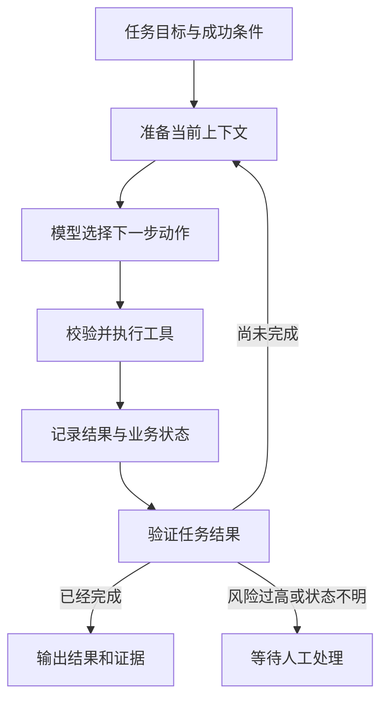

我最初理解 Agent 时，注意力总在模型上。模型能不能识别意图，能不能挑对工具，Prompt 要怎样写。拿 Codex 和 Claude Code 对照以后，这个解释很快就不够用了。它们能够在陌生项目里搜索代码、修改文件、运行测试，失败后还能根据新报错继续工作。模型只负责每一轮的判断，外面还有一套 Runtime 在准备信息、执行工具和检查结果。

构建 Agent 的问题因此可以拆开。先定义任务和成功条件，再准备上下文，让模型选择下一步动作。Runtime 校验工具调用并保存状态，验证器根据真实结果决定继续、完成或转人工。

## 先分清模型、Workflow 和 Agent

模型接收输入并生成一次输出。它可以回答问题，也可以返回结构化的工具调用参数。

Workflow 把执行顺序写在程序里。请假系统可以固定执行参数收集、余额校验、用户确认和创建申请。每一步何时发生，由代码决定。

Agent 允许模型根据当前状态选择下一步。代码排查时，它可以先搜索错误码，也可以沿着调用关系读取文件。测试失败以后，它再决定继续修改还是换一个假设。

生产系统经常把两者放在一起。退款校验、权限和状态更新走固定流程，模型处理意图理解、信息补全和异常解释。这样既保留灵活性，也能管住有副作用的操作。

## 七层结构

| 层 | 负责的问题 | 主要产物 |
| --- | --- | --- |
| 任务层 | 要完成什么，什么状态算成功 | 目标、边界、验收条件 |
| 上下文层 | 这一轮应该让模型看到什么 | Prompt、项目规则、检索结果、工具返回 |
| 模型层 | 下一步采取什么动作 | 回答、工具选择、结构化参数 |
| 工具层 | 怎样读取环境并改变外部系统 | Tool Schema、执行结果、错误类型 |
| 状态与编排层 | 已经做到哪一步，接下来允许走哪里 | 任务状态、分支、暂停与恢复 |
| 安全与可靠性层 | 怎样限制风险并处理未知结果 | 权限、审批、幂等、审计 |
| 验证与评测层 | 怎样证明任务完成并持续改进 | 测试证据、指标、执行记录 |

这些层会在一次任务里交替工作。分层的意义在于出现问题时能知道该改哪里。检索漏掉制度文档，应检查上下文层。退款重复执行，应检查工具和可靠性。模型已经给出正确参数，系统却在重启后丢失进度，应检查状态持久化。

## 任务层先写清成功条件

“帮我处理退款”只有目标，没有验收条件。系统还需要确认用户身份、订单归属、可退金额和当前退款状态。最后怎样回复，也必须由业务状态决定。

代码 Agent 同样需要边界。“修复登录报错”至少要说明允许修改的仓库、需要运行的测试，以及能否新增依赖。成功条件可以写成测试通过、构建成功并且变更范围符合要求。

Agent 容易在这一层犯错。目标写得太宽，模型会自己补任务。验收条件只写“返回成功”，模型又可能把工具响应当成业务事实。可观察、可验证的条件更可靠。

## 上下文层只提供当前需要的信息

上下文可以包含 System Prompt、用户需求、项目规则、历史状态和工具结果。知识库 Agent 还会加入 RAG 召回的文档片段，代码 Agent 则常用文本搜索、AST 和 LSP 找到相关代码。

信息越多，Token 消耗越大，无关内容也会干扰判断。Runtime 应该先检索和过滤，再把少量可靠信息交给模型。权限也要在检索阶段处理，模型不该看到当前用户无权访问的 Chunk。

这一层的检索方式、Embedding 成本和代码搜索工具，单独放在系列第一篇 [构建 Agent（一）上下文从哪里来](/posts/coding-agent-context-rag-code-search/) 中。

## 模型层负责当前这一步的决策

模型读取当前状态，输出回答或工具调用。工具调用通常使用固定 Schema，让模型明确填写工具名和参数，Runtime 再做类型与业务校验。

高风险任务不适合只看模型自报的置信度。退款金额提取可以先使用经过评测的小模型，输入缺失、规则冲突或者结果低于业务阈值时再升级。阈值需要从测试数据中得出，不能凭一次演示决定。

模型路由和节点指标可以继续阅读 [小模型先走、大模型兜底](/posts/model-routing-and-evaluation/)。

## 工具层把决定变成现实

工具需要明确的输入、返回值和错误类型。一个退款工具至少接收订单号、退款金额和稳定的退款编号。工具内部重新查询订单并校验金额，不能因为模型已经检查过就省掉确定性校验。

代码 Agent 的工具通常包括文件读取、文本搜索、补丁修改、终端和 Git。通过 MCP 还可以接入工单、设计稿、数据库或公司内部服务。模型只能调用已经授权的工具，Runtime 决定调用是否执行。

错误返回也要能区分。参数错误可以让模型补充信息，请求超时只能说明当前结果未知，外部平台明确拒绝才可以进入失败状态。把所有异常都包装成一个 `false`，后续就无法可靠恢复。

## 状态与编排层保存执行进度

对话记录帮助模型理解“它”和“刚才那笔订单”指什么。业务状态负责保存已经确认的参数、完成步骤和外部操作结果。两者用途不同。

简单流程用普通代码或固定 Pipeline 已经够用。任务出现分支、暂停、人工确认和故障恢复时，可以使用 LangGraph 一类状态图。图里的每个节点仍然要有清楚的输入和输出，框架不会自动补齐业务规则。

这部分已经整理在 [LangChain 与 LangGraph](/posts/langchain-langgraph-production-workflow/) 中。

## 安全与可靠性由程序强制执行

Prompt 可以告诉模型不要删除文件，权限系统还要真的拦住删除命令。高风险工具应设置最小权限，参数进入工具后继续校验，执行前保留人工确认。调用记录需要写入审计日志。

副作用工具还要处理并发、超时和重复请求。退款第一次已经成功，但响应在网络中丢失，第二次请求必须继续携带同一个 `refund_id`。Worker 抢占任务要使用原子状态更新，超时状态应记录为 `unknown`，随后查询外部平台。

完整例子见 [Agent 的副作用工具](/posts/agent-side-effect-tools/)。RAG 场景的权限过滤见 [RAG 权限不应只留在原始文件上](/posts/rag-permission-boundary/)。

## 验证与评测决定系统能否上线

模型输出“已经修复”只能说明它作出了判断。代码 Agent 还要运行测试、类型检查和构建，必要时打开页面完成真实操作。业务 Agent 要查询数据库和外部平台状态。

上线前可以准备一组固定任务，记录任务完成率、关键节点成功率、人工介入比例，以及每次执行的成本和延迟。线上继续保存工具调用、错误类型和最终业务状态。某类任务经常失败时，才有证据判断应该改 Prompt、换模型、补工具还是调整流程。

## Codex 和 Claude Code 怎样对应这些层

假设任务是修复登录接口偶发返回 500 的问题，并补充测试。

Codex 会读取用户需求和 `AGENTS.md`，搜索登录接口和相关测试，修改代码后运行命令。测试报错会重新进入上下文，模型据此选择下一步。权限系统控制它能访问哪些文件、能否运行某条命令，最终测试和代码差异负责验证。

Claude Code 的过程很接近。它默认读取 `CLAUDE.md`，也能操作文件和终端，通过 MCP 连接外部工具。Hooks 可以在工具调用前后运行确定性检查，Subagents 可以把独立调研放在单独的上下文。

| 维度 | Codex | Claude Code |
| --- | --- | --- |
| 模型生态 | OpenAI 模型 | Anthropic Claude 模型 |
| 项目说明 | `AGENTS.md` | `CLAUDE.md` |
| 常用配置 | Codex 配置与权限体系 | `.claude` 配置与权限体系 |
| 扩展方式 | Skills、Hooks、MCP、插件与 Subagents | Skills、Hooks、MCP 与 Subagents |
| 常见入口 | 终端、IDE、桌面与远程任务 | 终端、IDE、桌面与浏览器任务 |

两者的产品功能会继续变化。面试时可以把区别放在模型生态、项目规则和配置方式上，随后回到共同的执行过程。用户给出目标，Runtime 准备上下文，模型选择工具，执行结果写回状态，验证通过后才输出完成。

## 面试时可以怎样回答

> 我会把 Agent 拆成任务、上下文、模型、工具、状态、安全和验证七层。先确定任务边界与验收条件，再让 Runtime 准备当前需要的信息。模型负责选择下一步动作，工具负责读取或改变外部环境，状态层保存执行进度。高风险操作由权限、审批和幂等机制保护，最后使用测试或业务状态验证结果。
>
> Codex 和 Claude Code 都可以用来解释这套结构。它们会读取项目规则，搜索和修改代码，再运行测试。Codex 默认使用 `AGENTS.md`，Claude Code 默认使用 `CLAUDE.md`。两者的模型与配置生态不同，Agent 的执行循环很接近。

## 系列阅读顺序

DeepSeek Harness 的实现细节单独整理在 [DeepSeek Harness 学习笔记](/posts/deepseek-harness-notes/) 中。这个系列从 Agent Preset 进入，再继续拆 Cordis、会话、工具执行链和工作流。

1. [构建 Agent（一）上下文从哪里来](/posts/coding-agent-context-rag-code-search/)，其中 RAG 部分按照 [文档解析与切片](/posts/rag-document-parsing-and-chunking/)、[切片策略](/posts/rag-chunking-strategies-ragflow-mapping/)、[检索与重排](/posts/rag-retrieval-reranking-core-concepts/) 的顺序继续展开
2. 工具 Schema、参数校验与错误设计
3. 状态、编排和故障恢复
4. 权限、幂等与人工确认
5. 验证、评测和模型路由

后面的主题已经有部分独立笔记，总纲会随着学习继续补链接。第一篇先把上下文讲清楚，因为模型每一次决策，都受它当时看到的信息限制。

## 参考资料

- [Codex CLI](https://learn.chatgpt.com/docs/codex/cli)
- [Codex 的 AGENTS.md 说明](https://learn.chatgpt.com/docs/agent-configuration/agents-md)
- [Claude Code 概览](https://code.claude.com/docs/en/overview)
- [Claude Code 的项目记忆](https://code.claude.com/docs/en/memory)
- [Claude Code Hooks](https://code.claude.com/docs/en/hooks)
- [Claude Code Subagents](https://code.claude.com/docs/en/sub-agents)
